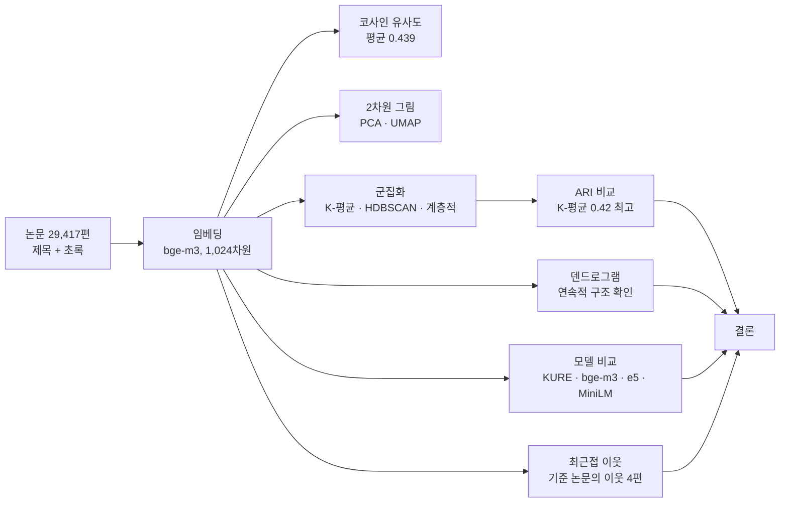

# 임베딩 실습: 수산·해양 논문 제목·초록의 의미 군집 분석

무료 임베딩 모델로 수산·해양 분야 영어 논문 **29,417편**을 벡터로 바꾸고, 벡터끼리의 거리로 논문이 토픽별로 모이는지 확인한 실습입니다.
노트북 「임베딩 실습」(단어 30개 예제)의 1~8단계를 논문 데이터에 맞게 그대로 따라 했습니다.

---

## 1. 목표

- 임베딩(벡터화)과 코사인 유사도의 개념을 실제 데이터로 확인한다.
- 최근접 이웃 검색, 2차원 시각화, 군집화를 차례로 적용한다.
- 여러 임베딩 모델을 같은 조건에서 비교한다.
- 결과 해석과 한계를 함께 정리한다.

---

## 2. 용어 정의

| 용어 | 뜻 |
|---|---|
| **임베딩(embedding)** | 글(단어·문장·문서)을 숫자 여러 개로 된 벡터로 바꾼 것. 뜻이 비슷한 글은 벡터도 가깝게 나오도록 학습된다. |
| **임베딩 모델** | 글을 벡터로 바꾸는 학습된 모델. 이 실습에서는 Hugging Face에서 무료로 받은 모델을 썼다. |
| **코사인 유사도(cosine similarity)** | 두 벡터가 가리키는 방향이 얼마나 같은지를 나타내는 값. 1에 가까울수록 비슷하고, 0이면 무관, −1이면 반대다. 벡터 길이를 1로 맞추면(정규화) 내적이 곧 코사인 유사도가 된다. |
| **코사인 거리** | 1 − 코사인 유사도. 값이 작을수록 가깝다. |
| **최근접 이웃(nearest neighbor)** | 기준 벡터와 가장 가까운 벡터 k개. |
| **PCA(주성분 분석)** | 분산이 가장 큰 방향 2개로 직선 투영해서 2차원으로 줄이는 방법. 선형 변환이라 원래 거리 구조를 잘 보존하지만, 복잡한 군집 구조는 잘 드러내지 못한다. |
| **UMAP** | 원래 공간에서 가까운 이웃 관계를 살려서 2차원 좌표를 새로 만드는 방법. 군집이 잘 드러나지만, 그림 속 간격이 실제 거리와 정확히 같지는 않다. |
| **K-평균(K-Means)** | 군집 수 k를 미리 정하고, 각 벡터를 가장 가까운 중심에 배정하는 방법. |
| **계층적 군집(Agglomerative)** | 가장 가까운 두 군집을 하나씩 합쳐 가다 k개에서 멈추는 방법. 결과를 덴드로그램으로 그릴 수 있다. |
| **HDBSCAN** | 밀도가 높은 곳을 군집으로 보고, 밀도가 낮은 점은 이상치(−1)로 분류하는 방법. 군집 수를 미리 정하지 않는다. |
| **ARI(조정 랜드 지수, Adjusted Rand Index)** | 군집 결과가 실제 라벨과 얼마나 같은지를 나타내는 값. 1이면 완전히 일치, 0 근처면 무작위 수준. 군집 번호 자체는 상관없다. |
| **토픽(topic)** | OpenAlex가 논문마다 자동으로 붙인 주제 라벨. 이 실습에서는 정답 범주로 사용했다. |

---

## 3. 데이터

### 3.1 출처와 수집

- **출처**: [OpenAlex](https://openalex.org) API (메타데이터는 CC0 라이선스)
- **수집 스크립트**: `collect_openalex.mjs` (Node.js)
- **결과 파일**: `works.csv` (논문 제목·초록·토픽 라벨)

### 3.2 수집 기준

1. **주 토픽(primary topic)** 이 아래 6개 중 하나인 논문만 가져왔다.
2. **발행 연도**: 2015~2025년.
3. **초록이 있는** 논문만 가져왔다. 제목이나 초록이 비어 있으면 제외했다.
4. **토픽당 최대 5,000편**. OpenAlex가 돌려준 순서대로 앞에서부터 받았다(무작위 추출 아님).

### 3.3 토픽(범주) 6개

| 토픽 (OpenAlex ID) | 논문 수 |
|---|---:|
| Fisheries and Aquaculture (T14405) | 5,000 |
| Ichthyology and Marine Biology (T11387) | 5,000 |
| Cephalopods and Marine Biology (T12596) | 4,418 |
| Marine and Coastal Ecosystems (T13485) | 5,000 |
| Food Industry and Aquatic Biology (T14010) | 5,000 |
| Coastal and Marine Management (T12414) | 5,000 |
| **합계** | **29,418** → 빈 칸 제거 후 **29,417** |

- Cephalopods 토픽은 해당 논문이 4,418편뿐이라 5,000편을 채우지 못했다.
- 토픽은 6개 모두 수산·해양 분야라서 서로 겹치는 부분이 있다. (예: Fisheries and Aquaculture와 Food Industry)
- 데이터는 영어 중심이지만, 일부 인도네시아어 논문이 섞여 있다.

### 3.4 토픽을 고른 과정

처음에는 수산·해양 토픽 6개를 그대로 썼다. 이후 수산학 분야별(양식학, 생리학, 수산·어업, 어류학, 해양 관리) 5개로 바꾸는 것도 검토했지만, 이미 받아 둔 데이터를 유지하기로 했다. 따라서 보고서의 결과는 **6개 토픽 기준**이다.

---

## 4. 방법

### 4.1 단계

| 단계 | 내용 |
|---|---|
| 1. 준비 | 라이브러리 설치, GPU 확인 |
| 2. 임베딩 | 제목 + 초록을 합쳐서 벡터화 (bge-m3, 1,024차원) |
| 3. 코사인 유사도 | 2,000편 샘플에서 유사도 계산 |
| 4. 최근접 이웃 | 논문 하나의 이웃 찾기 |
| 5. 시각화 | PCA와 UMAP으로 2차원 그림 (토픽별 300편) |
| 6. 군집화 | K-평균, HDBSCAN, 계층적 군집과 ARI 비교, 덴드로그램 |
| 7. 모델 비교 | 4개 모델을 같은 3,000편 샘플에서 비교 |
| 8. 직접 해 보기 | 군집 수 비교, 교차 분야 논문 찾기, 문장 비교 |

### 4.2 모델

| 모델 | 차원 | 특징 |
|---|---:|---|
| BAAI/bge-m3 | 1,024 | 다국어, 전체 데이터 임베딩에 사용 |
| nlpai-lab/KURE-v1 | 1,024 | 한국어 검색용 모델 |
| intfloat/multilingual-e5-small | 384 | 가볍고 빠른 다국어 모델. 문서 앞에 `passage: ` 접두어 사용 |
| paraphrase-multilingual-MiniLM-L12-v2 | 384 | 입력을 128토큰까지만 읽음 |

- 모든 벡터는 L2 정규화했다.
- 입력 최대 길이는 256토큰으로 제한했다.

---

## 5. 결과

### 5.0 전체 흐름

각 그래프가 앞 단계의 결과를 받아서 다음 질문에 답하는 구조예요.



- **임베딩 → 코사인·이웃**: 벡터끼리의 거리를 직접 계산하는 단계예요.
- **임베딩 → 2차원 그림**: 1,024차원을 2차원으로 줄여서 눈으로 확인해요. 그림은 거리 계산이 아니라 **모양을 보는 용도**예요.
- **임베딩 → 군집화 → ARI**: 군집이 토픽 라벨과 얼마나 맞는지 숫자로 확인해요.
- **덴드로그램**: 계층적 군집이 어떤 순서로 합쳐지는지 보여서, 군집 경계가 뚜렷한지 확인해요.
- **모델 비교**: 같은 조건에서 임베딩 모델만 바꿔서 ARI를 비교해요.

### 5.1 임베딩 모델 비교 (같은 3,000편 샘플, K-평균 k=6)

| 모델 | 차원 | ARI |
|---|---:|---:|
| KURE-v1 | 1,024 | **0.413** |
| bge-m3 | 1,024 | 0.408 |
| multilingual-e5-small | 384 | 0.353 |
| paraphrase-multilingual-MiniLM-L12-v2 | 384 | 0.317 |

- KURE-v1과 bge-m3는 0.005 차이라서 사실상 동점이다.
- 1,024차원 모델이 384차원 모델보다 높았다.
- 한국어 검색용인 KURE-v1이 영어 논문에서도 가장 높았다.
- 샘플 한 번으로 비교한 결과라서, 샘플을 바꾸면 순위가 달라질 수 있다.

### 5.2 군집화 결과 (bge-m3, 전체 29,417편)

| 방법 | 설정 | ARI | 해석 |
|---|---|---:|---|
| **K-평균** | k=6 | **0.420** | 가장 잘 나뉨 |
| K-평균 | k=4 / 5 / 8 | 0.389 / 0.404 / 0.477 | k가 클수록 ARI가 높음 |
| HDBSCAN | PCA 50차원, 최소 군집 크기 50 | 0.022 | 군집 3개, 이상치 9,995편 (거의 무작위) |
| 계층적 군집 | 3,000편 샘플, 평균 연결 | 0.000 | 토픽과 전혀 맞지 않음 |

- 계층적 군집이 0이 나온 것은 한 덩어리에 몰리고 나머지만 떨어지는 전형적인 결과로 보인다. 평균 연결과 코사인 거리 조합이 이 데이터에 맞지 않았을 가능성이 크다.
- HDBSCAN은 원래 1,024차원에서 계산하면 매우 오래 걸려서, 50차원으로 줄여서 계산했다. 이 때문에 설정이 K-평균과 같지 않다.

### 5.3 그래프 설명

**(a) PCA와 UMAP 비교 (토픽별 300편씩)**

- **PCA**: 토픽들이 크게 겹쳐 있다. 주황(해양 관리)과 파랑(연체류) 정도만 구분된다.
- **UMAP**: 주황, 빨강(식품), 보라(어류학), 파랑(연체류)이 각각 따로 뭉친다. 초록(양식)과 갈색(해양 생태계)은 가운데에서 섞인다.
- UMAP의 간격 크기는 실제 거리와 정확히 같지 않다. 뭉쳐 있는지만 보고, 정확한 거리는 코사인으로 판단한다.

**(b) 계층적 군집의 덴드로그램 (토픽별 300편씩, 평균 연결)**

- 세로축은 합쳐질 때의 코사인 거리다. 아래에서 일찍 합쳐진 논문끼리가 가깝다.
- 0.6~0.7 근처에서 큰 가지가 합쳐진다. 뚜렷한 몇 개 덩어리로 끊어지지 않고 연속적으로 이어진다.
- 토픽 경계가 뚜렷하지 않다는 뜻이며, 계층적 군집의 ARI가 낮았던 결과와 같은 맥락이다.

### 5.4 코사인 유사도와 최근접 이웃

- 샘플 2,000편의 평균 코사인은 **0.439**다. 아무 두 논문을 골라도 대략 이 정도 값이 나온다.
- 기준 논문 「Aquaculture policy: Designing licenses for environmental regulation」의 이웃 4편은 모두 양식 정책 또는 양식 기술 논문이었다. 이웃 중 하나는 다른 토픽(Coastal and Marine Management)인데도 0.804로 가장 가까웠다.
- 상어 연구, 식품 부산물 연구처럼 한 토픽 안에서 주제가 뚜렷한 논문은 이웃이 모두 같은 토픽에서 나왔다.

### 5.5 교차 분야 논문 찾기

- 무작위 5편은 이웃이 모두 같은 토픽이었다.
- 샘플 3,000편 중 이웃의 다른 토픽 비율이 100%인 논문을 찾았다. 그런데 이 논문들은 실제로 교차 분야라기보다 **라벨 경계가 애매한 경우**였다.
  - 파키스탄 수산업 경제 논문은 Food Industry로 분류됐지만, 이웃은 모두 Fisheries and Aquaculture였다.
  - 인도네시아어 논문끼리 가까이 모였다. 임베딩이 주제뿐 아니라 **언어**에도 크게 반응한다는 뜻이다.

### 5.6 문장 비교 (e5-small)

| 문장 쌍 | 코사인 |
|---|---:|
| 같은 뜻 (「expanding rapidly」 ↔ 「grown quickly」) | 0.957 |
| 반대 뜻 (「expanding」 ↔ 「declining sharply」) | 0.912 |
| 같은 주제, 다른 내용 | 0.83 안팎 |
| 다른 주제 | 0.78~0.84 |

- 같은 뜻 쌍이 가장 높았다.
- 반대 뜻 쌍도 단어가 겹쳐서 높게 나왔다. 임베딩 코사인만으로는 긍정·부정 같은 의미 차이를 구분하기 어렵다.
- e5-small은 대부분의 문장 쌍이 0.78 이상으로 몰려서, **절대 값보다 순위**로 해석해야 한다.

---

## 6. 결론

1. 임베딩으로 논문을 토픽별로 묶으면 **어느 정도는 잘 나뉜다**(K-평균 ARI 0.42). 다만 토픽끼리 경계가 흐려서 완벽하게 나뉘지는 않는다.
2. 모델 중에서는 **KURE-v1과 bge-m3**가 가장 좋았고, 1,024차원 모델이 384차원 모델보다 나았다.
3. 군집 수를 늘리면 ARI가 올라갔다. 토픽 안에 세부 주제가 있다는 뜻이며, 라벨 6개가 데이터 구조의 전부는 아니다.
4. 밀도 기반(HDBSCAN)과 계층적 군집은 이 데이터에서 잘 맞지 않았다.
5. 임베딩은 주제뿐 아니라 **언어**와 **단어 겹침**에도 크게 반응한다.

---

## 7. 한계

- 토픽 라벨은 OpenAlex가 자동으로 붙인 값이라 정답이 아니다.
- 토픽당 5,000편을 OpenAlex 순서대로 받았으므로 특정 연도나 학술지로 치우쳤을 수 있다.
- 모델 비교는 샘플 3,000편 한 번으로 했다. 샘플을 바꿔 여러 번 평균 내면 더 믿을 만하다.
- HDBSCAN은 차원을 50으로 줄여서 계산했다.
- 문장 비교는 문장 몇 개로만 확인했다.

---

## 8. 재현 방법

### 8.1 데이터 수집

```bash
OPENALEX_KEY=YOUR_KEY MAILTO=YOUR_EMAIL node collect_openalex.mjs
```

- `YOUR_KEY`에는 [OpenAlex](https://openalex.org/settings/api)에서 발급한 무료 키를 넣는다.
- 키는 저장소에 올리지 않는다.

### 8.2 노트북 실행

1. Google Colab에서 T4 GPU 런타임을 선택한다.
2. `works.csv`를 업로드한다.
3. 셀을 위에서부터 차례로 실행한다. 임베딩(bge-m3, 29,417편)은 약 20~25분 걸린다.

---

## 9. 파일 구성

| 파일 | 내용 |
|---|---|
| `collect_openalex.mjs` | OpenAlex 수집 스크립트 |
| `works.csv` | 수집한 논문 데이터 (제목·초록·토픽) |
| `colab_cells.py` | 노트북 셀 코드 |
| `figures/` | 그래프 이미지 (PCA·UMAP 비교, 덴드로그램) |
| `README.md` | 이 문서 |

> **주의**: 임베딩 결과 파일(`emb_bge_m3.npy`, 약 120MB)은 GitHub 파일 크기 제한(100MB)을 넘으므로 올리지 않는다. 필요하면 노트북에서 다시 계산한다.
